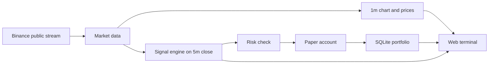
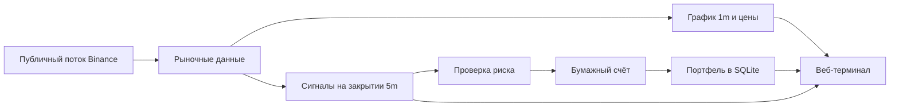

# CryptoAI Trader

**English.** A paper-trading terminal you can run locally: live public Binance data, explainable long signals, and a virtual **$10,000** portfolio. No exchange API keys. No real orders.

**Русский.** Paper-trading терминал, который запускается локально: живые публичные данные Binance, объяснимые лонг-сигналы и виртуальный портфель **$10 000**. Без API-ключей биржи. Без реальных ордеров.

[English](#english) · [Русский](#russian)

Paper trading only. Not financial advice.
Только бумажная торговля. Не является инвестиционной рекомендацией.

---

<a id="english"></a>

## English

CryptoAI Trader is a working demo of a controlled trading loop. It watches BTC, ETH, and SOL on Binance, scores long setups with a transparent rules engine, sizes each trade against a fixed risk budget, and marks a virtual book to live prices.

The signal engine is deterministic on purpose. Every signal carries a numeric confidence score and a plain-language reason built from the indicators that fired. It is not a language model, and it does not place an order on an exchange. The point of the demo is the control loop — data, signal, risk, fill, P&L — not a claimed return.

### What the demo shows

| Screen | What an observer sees |
|---|---|
| Dashboard | Cash, equity, realized and unrealized P&L, win rate, average profit, and whether the risk freeze is on |
| Terminal | Live 1-minute chart, last price, and a manual market buy |
| AI Feed | Each signal: confidence, entry, stop, target, reason, and whether it was taken or skipped |
| Positions | Open and closed paper positions, with a manual close |

Default universe: **BTCUSDT**, **ETHUSDT**, **SOLUSDT**. Charts use 1-minute candles. Signals are scored on closed 5-minute candles.

### How a trade happens



1. The API subscribes to Binance public WebSocket and REST. No account and no API key.
2. On each closed 5-minute candle the engine scores a long setup. It emits a signal only when confidence is above **75**.
3. Risk then decides. A new automatic entry is skipped if that symbol already has an open position, if the sized order is below **$10**, or if the daily kill switch is on.
4. A taken signal is filled in the paper account at the last price, with taker fee and slippage. Stop and take-profit are attached to the position and watched on live prices.
5. The browser receives prices, candles, signals, positions, and account snapshots over a WebSocket, and falls back to REST polling if the socket drops.

Manual market buys and closes are available from the terminal. The kill switch applies to automatic entries.

### Risk limits

These are the defaults an investor can inspect in [`.env.example`](.env.example). They are enforced in code, not written as a policy slide.

| Rule | Default |
|---|---|
| Starting cash | $10,000 |
| Risk per trade | 1.5% of equity, measured to the stop |
| Take-profit | 1.5× the stop distance |
| Daily kill switch | New automatic entries freeze for 24 hours if equity is down 3% or more from the UTC-day open |
| One position | At most one open position per symbol |
| Fill assumptions | 0.05% taker fee, 0.02% slippage |
| Side | Long only |

Indicators behind the score: bullish engulfing, RSI(14), MACD(12, 26, 9), EMA(20), and Bollinger Bands(20, 2). Stop is placed strictly below entry. If it cannot be, the signal is dropped.

### Stack

| Layer | Choice |
|---|---|
| API | Python, FastAPI, Uvicorn, SQLite |
| Market | Binance public REST and WebSocket |
| Web | React, TypeScript, Vite, Lightweight Charts |
| Contract | Shared schemas in `apps/api/app/schemas.py` and `apps/web/src/types.ts` |
| Tests | pytest for market data, signals, risk, paper fills, and the pipeline |

API version in this demo: **0.1.0**. Interactive API docs are served at `http://localhost:8000/docs` while the API is running.

### Run the demo

The one-command start script expects **Windows**, with the virtualenv at `apps/api/.venv`. You need Python 3 and Node.js installed.

First time, install dependencies:

```bash
cd apps/api
python -m venv .venv
.venv\Scripts\activate
pip install -r requirements.txt

cd ..\..\apps\web
npm install

cd ..\..
npm install
```

Then, from the repository root, start the API (`:8000`) and the UI (`:5173`):

```bash
npm run dev
```

Open [http://localhost:5173](http://localhost:5173). `Ctrl+C` stops both processes.

Optional: copy [`.env.example`](.env.example) to `apps/api/.env` and edit any `CRYPTOAI_*` value. Without that file the defaults above are used. Restart `npm run dev` after a change. The confidence threshold of 75 is fixed in the signal engine and is not an environment flag.

API tests:

```bash
cd apps/api
.venv\Scripts\python.exe -m pytest
```

### Scope

This repository is a paper-trading demo.

- Orders stay inside the virtual account. Nothing is sent to Binance as a trade.
- Market data is public. The demo does not ask for exchange keys.
- Results on the dashboard are simulated fills under the fee, slippage, and risk rules above. They are not evidence of future performance.
- Not financial advice.

---

<a id="russian"></a>

## Русский

CryptoAI Trader — рабочее демо управляемого торгового цикла. Оно смотрит BTC, ETH и SOL на Binance, оценивает лонг-сетапы прозрачным правил-движком, ограничивает размер сделки фиксированным риском и переоценивает виртуальный портфель по живой цене.

Движок сигналов намеренно детерминированный. У каждого сигнала есть числовая уверенность и причина обычным языком — из тех индикаторов, которые сработали. Это не языковая модель, и на биржу ордер не уходит. Смысл демо — сам контур: данные, сигнал, риск, исполнение, P&L. Не обещание доходности.

### Что видно в демо

| Экран | Что видит наблюдатель |
|---|---|
| Dashboard | Кэш, equity, реализованный и нереализованный P&L, win rate, средняя прибыль и статус риск-паузы |
| Terminal | Живой график 1m, последняя цена и ручная рыночная покупка |
| AI Feed | Каждый сигнал: уверенность, вход, стоп, цель, причина и статус — взят или пропущен |
| Positions | Открытые и закрытые бумажные позиции, с ручным закрытием |

Пары по умолчанию: **BTCUSDT**, **ETHUSDT**, **SOLUSDT**. График строится по свечам 1 минуты. Сигналы считаются по закрытым свечам 5 минут.

### Как проходит сделка



1. API подписывается на публичные WebSocket и REST Binance. Счёт и API-ключ не нужны.
2. На каждой закрытой 5-минутной свече движок оценивает лонг. Сигнал публикуется только если уверенность выше **75**.
3. Дальше решает риск. Автоматический вход пропускается, если по этой паре уже есть открытая позиция, если расчётный объём меньше **$10** или если включён дневной kill switch.
4. Принятый сигнал исполняется в бумажном счёте по последней цене, с комиссией тейкера и проскальзыванием. Стоп и тейк-профит крепятся к позиции и следят за живой ценой.
5. Браузер получает цены, свечи, сигналы, позиции и снимки счёта по WebSocket. Если сокет обрывается, интерфейс переходит на опрос REST.

Ручные рыночные покупки и закрытия доступны из терминала. Kill switch относится к автоматическим входам.

### Лимиты риска

Это значения по умолчанию. Их можно сверить в [`.env.example`](.env.example). Они зашиты в код, а не вынесены в отдельный слайд.

| Правило | По умолчанию |
|---|---|
| Стартовый кэш | $10 000 |
| Риск на сделку | 1,5% equity, считая до стопа |
| Тейк-профит | 1,5× дистанции до стопа |
| Дневной kill switch | Новые автоматические входы замораживаются на 24 часа, если equity просела на 3% и больше от открытия UTC-дня |
| Одна позиция | Не больше одной открытой позиции на символ |
| Допущения исполнения | комиссия тейкера 0,05%, проскальзывание 0,02% |
| Сторона | Только лонг |

Оценка строится на bullish engulfing, RSI(14), MACD(12, 26, 9), EMA(20) и полосах Боллинджера (20, 2). Стоп всегда строго ниже входа. Если так поставить нельзя, сигнал отбрасывается.

### Стек

| Слой | Выбор |
|---|---|
| API | Python, FastAPI, Uvicorn, SQLite |
| Рынок | Публичные REST и WebSocket Binance |
| Веб | React, TypeScript, Vite, Lightweight Charts |
| Контракт | Общие схемы в `apps/api/app/schemas.py` и `apps/web/src/types.ts` |
| Тесты | pytest: рынок, сигналы, риск, бумажные сделки и пайплайн |

Версия API в этом демо: **0.1.0**. Пока API запущен, интерактивная документация доступна на `http://localhost:8000/docs`.

### Запуск

Скрипт одного запуска рассчитан на **Windows**, виртуальное окружение ожидается в `apps/api/.venv`. Нужны установленные Python 3 и Node.js.

Первый раз — зависимости:

```bash
cd apps/api
python -m venv .venv
.venv\Scripts\activate
pip install -r requirements.txt

cd ..\..\apps\web
npm install

cd ..\..
npm install
```

Дальше из корня репозитория поднимаются API (`:8000`) и интерфейс (`:5173`):

```bash
npm run dev
```

Откройте [http://localhost:5173](http://localhost:5173). `Ctrl+C` останавливает оба процесса.

По желанию скопируйте [`.env.example`](.env.example) в `apps/api/.env` и поправьте значения `CRYPTOAI_*`. Без файла работают значения по умолчанию из таблицы выше. После правки перезапустите `npm run dev`. Порог уверенности 75 задан в движке сигналов и не вынесен в переменную окружения.

Тесты API:

```bash
cd apps/api
.venv\Scripts\python.exe -m pytest
```

### Границы демо

Этот репозиторий — paper-trading демо.

- Ордера остаются внутри виртуального счёта. На Binance как сделка ничего не отправляется.
- Рыночные данные публичные. Ключи биржи демо не запрашивает.
- Цифры на дашборде — смоделированные сделки с комиссией, проскальзыванием и правилами риска выше. Это не доказательство будущей доходности.
- Не является инвестиционной рекомендацией.
